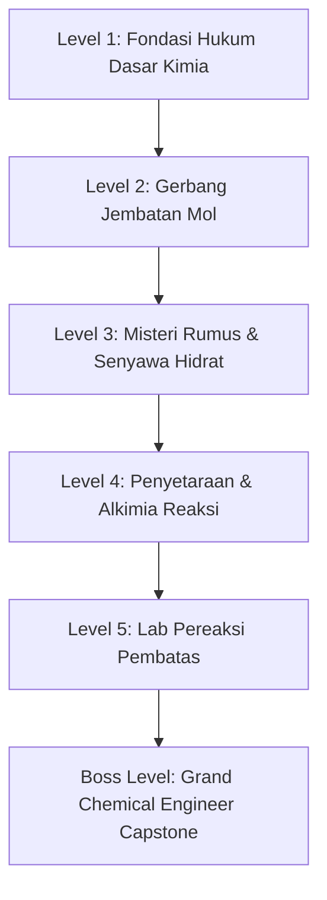

# Product Requirements Document (PRD)
## Platform Pembelajaran Kimia Interaktif: "StoiLab 11" (Stoikiometri Kelas 11)

---

## 1. Ringkasan Eksekutif & Visi Produk

### 1.1 Visi Produk
**StoiLab 11** adalah aplikasi web pembelajaran kimia interaktif modern yang dirancang khusus untuk siswa SMA Kelas 11 (Fase F - Kurikulum Merdeka). Platform ini mentransformasikan materi **Stoikiometri**—yang sering dianggap abstrak, rumit, dan sarat rumus matematika—menjadi petualangan visual interaktif yang menyenangkan, intuitif, dan bermakna melalui pendekatan visualisasi partikulat, simulasi laboratorium virtual, kalkulator alur jembatan mol, serta jalur belajar gamifikasi (*Quest Map*).

### 1.2 Target Pengguna
- **Pengguna Utama**: Siswa SMA Kelas 11 yang sedang mempelajari konsep mol, stoikiometri reaksi, dan pereaksi pembatas.
- **Pengguna Pendukung**: Guru Kimia SMA yang membutuhkan media pembelajaran visual/interaktif untuk demonstrasi di kelas atau penugasan mandiri siswa.

### 1.3 Nilai Tambah Utama (Value Propositions)
1. **Konseptualisasi Visual Partikulat**: Siswa tidak hanya menghafal angka, melainkan melihat partikel/molekul bereaksi secara visual di tingkat sub-mikroskopik.
2. **Jembatan Mol Step-by-Step**: Mengubah kerumitan konversi massa-mol-partikel-volume menjadi peta interaktif yang dapat diselesaikan langkah demi langkah.
3. **Analogi Berbasis Kehidupan Nyata**: Konsep abstrak seperti *pereaksi pembatas* dijelaskan melalui analogi konkret (misal: perakitan burger/sandwich atau kantung udara mobil).
4. **Gamified Quest Map**: Alur belajar terstruktur dengan level tantangan berjenjang, perolehan XP, dan lencana pencapaian untuk menjaga motivasi belajar.

---

## 2. Standar Kurikulum & Tujuan Pembelajaran (Capaian Pembelajaran)

Berdasarkan Capaian Pembelajaran Kimia Fase F (Kelas 11):
1. **Pemahaman Hukum Dasar Kimia**: Peserta didik mampu menganalisis keteraturan hukum Lavoisier, Proust, Dalton, Gay-Lussac, dan Avogadro.
2. **Penguasaan Konsep Mol**: Peserta didik mampu mengonversi antara massa ($g$), jumlah mol ($n$), jumlah partikel ($X$), volume gas ($V$ pada STP/RTP/kondisi gas ideal), serta konsentrasi larutan/molaritas ($M$).
3. **Penentuan Rumus Kimia**: Peserta didik mampu menentukan Rumus Empiris (RE), Rumus Molekul (RM), kadar zat dalam senyawa, dan rumus air kristal (senyawa hidrat).
4. **Stoikiometri Persamaan Reaksi**: Peserta didik mampu menyetarakan persamaan reaksi dan menerapkan perbandingan koefisien reaksi untuk menentukan kuantitas zat yang terlibat.
5. **Penentuan Pereaksi Pembatas & Rendemen**: Peserta didik mampu mengidentifikasi zat yang habis terlebih dahulu (*limiting reagent*), menghitung massa zat sisa, menghitung hasil teoritis (*theoretical yield*), dan menghitung persen rendemen (*percent yield*).

---

## 3. Alur Belajar & Kurikulum Berjenjang (Quest Map)

Platform mengadopsi struktur pembelajaran **Quest Map 5 Level + 1 Boss Level**:



### Rincian Modul per Level:

| Level | Judul Quest | Submateri Inti | Fitur / Aktivitas Interaktif |
|---|---|---|---|
| **Level 1** | *Fondasi Hukum Dasar Kimia* | • Hukum Kekekalan Massa (Lavoisier)<br>• Hukum Perbandingan Tetap (Proust)<br>• Hukum Kelipatan Berganda (Dalton)<br>• Hukum Perbandingan Volume (Gay-Lussac)<br>• Hipotesis Avogadro | Neraca virtual interaktif untuk membuktikan massa sebelum vs sesudah reaksi; simulasi perbandingan volume gas balon. |
| **Level 2** | *Gerbang Jembatan Mol* | • Definisi Mol & Bilangan Avogadro ($6{,}02 \times 10^{23}$)<br>• Massa Molar ($Ar$ dan $Mr$)<br>• Volume Molar Gas ($STP = 22{,}4\text{ L/mol}$, $RTP = 24\text{ L/mol}$, $PV=nRT$)<br>• Molaritas Larutan ($M = n / V$) | **Interactive Mole Bridge Navigator**: visualisasi grafis node konversi massa $\leftrightarrow$ mol $\leftrightarrow$ partikel $\leftrightarrow$ volume $\leftrightarrow$ molaritas dengan animasi rute. |
| **Level 3** | *Misteri Rumus & Senyawa Hidrat* | • Persentase Komposisi Unsur (Kadar Zat)<br>• Rumus Empiris (RE) vs Rumus Molekul (RM)<br>• Air Kristal / Senyawa Hidrat ($CuSO_4 \cdot xH_2O$) | Mini-lab virtual pemanasan krusibel senyawa hidrat hingga massanya konstan untuk mengungkap nilai $x$. |
| **Level 4** | *Alkimia Persamaan Reaksi* | • Penyetaraan Reaksi Kimia (Hukum Lavoisier)<br>• Arti Fisis Koefisien Reaksi sebagai Rasio Mol<br>• Perhitungan Stoikiometri Sederhana ($mol_B = \frac{koef_B}{koef_A} \times mol_A$) | Interactive Reaction Balancer game (slider partikel reaktan & produk hingga setimbang). |
| **Level 5** | *Lab Pereaksi Pembatas & Rendemen* | • Konsep Zat Pembatas vs Berlebih (B-R-S: Mula-mula, Reaksi, Sisa)<br>• Identifikasi Pereaksi Pembatas (Membagi Mol dengan Koefisien)<br>• Persen Hasil / Rendemen Reaksi ($\frac{\text{Aktual}}{\text{Teoritis}} \times 100\%$) | **Interactive Particulate Simulator**: Mengatur jumlah reaktan (misal: $2H_2 + O_2 \to 2H_2O$), melihat molekul terakit menjadi produk secara visual, dan menghitung sisa molekul reaktan berlebih. |
| **Boss Level** | *Grand Chemical Engineer* | Studi Kasus Industri Terintegrasi:<br>• Desain Kantung Udara Mobil ($2NaN_3 \to 2Na + 3N_2$)<br>• Sintesis Pupuk Amonia Haber-Bosch | Simulasi kasus multi-tahap di mana siswa harus menghitung kebutuhan bahan baku, efisiensi reaktan, dan rendemen pabrik. |

---

## 4. Spesifikasi Fitur Unggulan

### 4.1 Interactive Quest Map (Jalur Petualangan)
- **Visualisasi Peta**: Peta interaktif berupa node-node level melengkung (*curved path*) dengan animasi glowing pada level yang sedang aktif.
- **Progression State**: 
  - Status tiap level: `Locked`, `In Progress`, `Completed`.
  - Sistem Bintang (1 - 3 Bintang) per level berdasarkan akurasi kuis.
  - XP Counter & Level Bar di header antarmuka.
- **Persistensi Data**: Progres belajar, bintang, lencana, dan skor kuis tersimpan di `LocalStorage` browser sehingga tidak hilang saat direfresh.

### 4.2 Interactive Mole Bridge Calculator (Kalkulator Jembatan Mol)
- **Peta Rute Grafis**: Diagram interaktif yang menampilkan pusat konversi (titik pusat: **MOL**) terhubung ke 4 cabang:
  1. Massa (Gram) $\longleftrightarrow$ Mol ($\times / \div Mr$)
  2. Partikel (Atom/Molekul) $\longleftrightarrow$ Mol ($\times / \div 6{,}02 \times 10^{23}$)
  3. Volume Gas (Liter) $\longleftrightarrow$ Mol ($\times / \div 22{,}4\text{ L}$ pada STP)
  4. Molaritas ($M$) $\longleftrightarrow$ Mol ($\times / \div \text{Volume Larutan}$)
- **Mode Solver Langkah-demi-Langkah**:
  - Siswa memilih "Titik Awal" dan "Titik Tujuan" (misal: Massa $\to$ Volume STP).
  - Masukkan nilai angka & rumus senyawa (misal: $4{,}4\text{ gram } CO_2$).
  - Sistem menampilkan kalkulasi terpandu baris demi baris:
    - Langkah 1: Hitung $Mr$ $CO_2$ ($12 + 2 \times 16 = 44$).
    - Langkah 2: Hitung mol ($4{,}4 / 44 = 0{,}1\text{ mol}$).
    - Langkah 3: Konversi ke volume ($0{,}1 \times 22{,}4 = 2{,}24\text{ Liter}$).

### 4.3 Virtual Lab & Visualisasi Partikulat (Pereaksi Pembatas)
- **Canvas / Animasi Partikel Reaktif**:
  - Siswa dapat memilih reaksi standar:
    - $2H_2 + O_2 \longrightarrow 2H_2O$
    - $N_2 + 3H_2 \longrightarrow 2NH_3$
    - $CH_4 + 2O_2 \longrightarrow CO_2 + 2H_2O$
  - Kontrol interaktif: Slider untuk menentukan jumlah molekul reaktan A dan reaktan B di dalam bejana reaksi.
  - Tombol **"Reaksikan!"**: Animasi molekul saling bertumbukan dan membentuk molekul produk.
  - Analisis Hasil Otomatis:
    - Pereaksi Pembatas (*Limiting Reagent*): disorot dengan warna peringatan.
    - Pereaksi Berlebih (*Excess Reagent*) & Jumlah sisa molekul yang tidak bereaksi.
    - Jumlah molekul produk yang terbentuk.
  - Tabel B-R-S (Bagan Mula-mula, Reaksi, Sisa) otomatis ter-generate dari simulasi tersebut.

### 4.4 Modul Materi Micro-Learning
- Kartu konsep ringkas bergaya majalah modern dengan tipografi bersih.
- Komponen Formula Khusus (rendering subskrip & rumus kimia secara rapi dan estetis).
- **Pro-Tips / Catatan Penting**: Callout cards khusus ("Jebakan Soal", "Trik Cepat", "Miskonsepsi Umum").
- Analogi visual dunia nyata di setiap awal materi.

### 4.5 Bank Soal Adaptif & Gamifikasi Latihan
- **Tipe Soal**:
  - Pilihan Ganda Interaktif dengan animasi feedback (hijau jika benar, merah jika salah).
  - Soal Isian Singkat dengan toleransi desimal angka penting.
  - Drag-and-drop / Reorder urutan langkah hitungan.
- **Fitur Pembahasan Instan**: Penjelasan langkah pengerjaan komprehensif setelah menjawab.
- **Sistem Hadiah (Achievements & Badges)**:
  - 🏅 *Avogadro's Disciple*: Selesaikan Level 2 dengan skor sempurna.
  - ⚖️ *Lavoisier's Scale*: Setarakan 5 reaksi kimia berturut-turut tanpa salah.
  - 🥪 *The Sandwich Alchemist*: Selesaikan tantangan Pereaksi Pembatas.
  - 🏆 *Grand Chemical Master*: Taklukkan Boss Level Capstone.

---

## 5. Spesifikasi Desain Antarmuka (UI/UX) & Estetika Visual

Sesuai arahan visual **"Modern Chemistry Lab"**:

### 5.1 Tema & Warna (Color Palette)
- **Dark Mode (Default)**:
  - Background Utama: `#0B0F19` (Deep Obsidian / Dark Lab)
  - Surface / Kartu: `#111827` dengan `border: 1px solid rgba(255, 255, 255, 0.08)` dan efek glassmorphism (`backdrop-filter: blur(16px)`).
  - Warna Primer (Chemistry Emerald): `#10B981` (Hover: `#34D399`)
  - Warna Sekunder (Cyber Cyan): `#06B6D4` (Glow: `#22D3EE`)
  - Warna Aksen Reaksi (Bismuth Violet / Flame Amber): `#8B5CF6` & `#F59E0B`
  - Warna Peringatan/Error: `#EF4444`
  - Teks: `#F9FAFB` (Utama), `#9CA3AF` (Sekunder)
- **Light Mode (Toggle)**:
  - Background: `#F8FAFC`
  - Surface: `#FFFFFF`
  - Border: `#E2E8F0`
  - Kontras tinggi untuk kenyamanan membaca di siang hari.

### 5.2 Tipografi
- **Font Utama (UI & Paragraf)**: `Plus Jakarta Sans`, `Outfit`, atau `Inter` (sans-serif modern, ramah, dan sangat terbaca).
- **Font Angka & Rumus**: `Fira Code` atau `JetBrains Mono` untuk menjaga perataan angka, eksponen, dan reaksi kimia.

### 5.3 Micro-Animations & Interaktivitas
- Efek hover kartu dengan subtle glow neon cyan/emerald (`box-shadow: 0 0 20px rgba(16, 185, 129, 0.2)`).
- Progress bar dengan animasi pengisian halus (*smooth fill animation*).
- Partikel reaktif di latar belakang hero section yang bergerak lambat menyerupai molekul gas di udara.
- Feedback suara subtle (opsional/muteable) saat klik tombol, jawaban benar, atau naik level.

---

## 6. Arsitektur Teknis

### 6.1 Stack Teknologi
- **Core**: React 19, TypeScript, Vite.
- **Styling**: Vanilla CSS murni dengan CSS Custom Properties (Design Tokens), Glassmorphism, CSS Grid & Flexbox, serta CSS Keyframe Animations.
- **Icons**: Lucide-React atau SVG icons modern kustom.
- **Math/Chemistry Notation**: KaTeX atau komponen penulisan rumus kimia berbasis React.
- **State Persistence**: React State + Browser `localStorage`.

### 6.2 Struktur Folder Proyek
```
src/
├── assets/             # SVG aset, audio klik, ilustrasi molekul
├── components/
│   ├── common/         # Button, Card, Modal, Badge, ProgressBar, ThemeToggle
│   ├── layout/         # Header/Navbar, Footer, Sidebar Navigation
│   ├── quest/          # QuestMap, LevelNode, LevelDetailModal
│   ├── simulator/      # LimitingReactantSim, MoleculeVisualizer, ReactionController
│   ├── calculator/     # MoleBridge, ConversionStepSolver, MrCalculator
│   └── quiz/           # QuizEngine, QuestionCard, ScoreSummary, StepExplanation
├── data/
│   ├── levelsData.ts   # Data kurikulum 5 level + boss level
│   ├── reactions.ts    # Database reaksi kimia untuk simulator
│   ├── quizBank.ts     # Bank soal per level dengan pembahasan
│   └── badges.ts       # Definisi lencana & kriteria perolehannya
├── hooks/              # useProgress, useTheme, useSound
├── types/              # Interface TypeScript (Level, Question, Molecule, Badge, dll.)
├── styles/
│   ├── tokens.css      # CSS variables (colors, typography, spacing, shadows)
│   ├── index.css       # Global reset & baseline styles
│   └── animations.css  # Micro-animations, glow, transitions
├── App.tsx             # Main view router / screen manager
└── main.tsx            # Entry point
```

---

## 7. Roadmap Implementasi

| Fase | Target Kerja | Output Utama |
|---|---|---|
| **Fase 1** | **Design System & Shell Aplikasi** | • Token warna, tema dark/light, glassmorphism card<br>• Navbar, Header profil siswa (XP & Bintang), footer |
| **Fase 2** | **Interactive Quest Map & Data Kurikulum** | • Visualisasi peta rute level 1 - 5 + Boss level<br>• Penyusunan konten ringkasan materi tiap level di `levelsData.ts`<br>• Sistem simpan progres di `localStorage` |
| **Fase 3** | **Interactive Mole Bridge Calculator** | • Diagram interaktif konversi massa, mol, partikel, volume, molaritas<br>• Input kalkulator step-by-step solver beserta penjelasan |
| **Fase 4** | **Simulasi Partikulat Pereaksi Pembatas** | • Bejana reaksi molekul interaktif dengan kontrol slider<br>• Animasi reaksi dan tabel B-R-S otomatis |
| **Fase 5** | **Engine Kuis, Pembahasan, & Sistem Lencana** | • Komponen kuis per level dengan penilaian langsung dan langkah pembahasan<br>• Halaman koleksi lencana/prestasi (*Achievements*) |
| **Fase 6** | **Polish, Audio Micro-effects, & Responsive Testing** | • Pengujian tampilan di perangkat Mobile & Desktop<br>• Optimasi performa dan audit aksesibilitas |

---

## 8. Kriteria Keberhasilan (Acceptance Criteria)

1. **Kelengkapan Materi**: Mencakup seluruh ruang lingkup stoikiometri kelas 11 dari hukum dasar kimia hingga pereaksi pembatas dan rendemen.
2. **Keterlibatan Siswa**: Siswa dapat mengoperasikan simulasi pereaksi pembatas dan kalkulator jembatan mol secara interaktif tanpa kendala teknis.
3. **Kualitas Tampilan**: Estetika modern, responsif untuk smartphone dan desktop, kontras warna yang nyaman, serta nuansa lab kimia masa depan yang memikat (*wow factor*).
4. **Kejelasan Solusi**: Setiap soal latihan memiliki pembahasan langkah-demi-langkah yang mendidik, bukan sekadar kunci jawaban.
